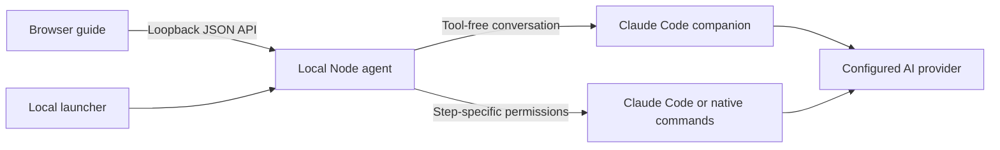

# Architecture

The Climb keeps the browser interface, local execution bridge, and process launcher separate. The runtime uses browser APIs and Node's standard library.

## Browser guide

`the-climb.html` contains the layout, stage definitions, interview, local state, connection handling, and companion. It can be opened as a document, but agent requests require the local server. The file-to-local transfer is an explicit, bounded URL-fragment handoff with a choice when existing answers conflict.

Device mode checks the browser Prompt API for an already available English text model. Each answer uses a disposable session and supports cancellation. In the connected guide, the browser can also use a supported installed Ollama model through the loopback-only device_tutor route. The route checks local model metadata, sends no tools, and cancels inference when the browser disconnects. The bundled field guide supplies lesson explanations, glossary lookup and step search when local inference is unavailable. Connected Claude uses the local bridge.

The portable HTML retrieves relevant excerpts from its own interview, lessons, setup instructions, glossary, Terminal habits, and playbook. Device replies use a bounded prompt with learner answers, the visible exercise, selections, and recent chat. The companion is a small persistent control. `COMPANION_MOVES` defines the three learning prompts. `companionContext()` supplies the current stage, observed checks, bounded recent messages, and up to three explicitly kept notes. The browser retains at most five kept notes and 30 recent companion messages. Notes have edit and remove controls.

Every one-at-a-time page (practice lessons, setup steps, and the steps of stages 3 to 6) uses one frame: a sticky top bar with the path on the left, progress dots in the centre and a contents menu on the right, then the task, then a bottom bar with the way back on the left and the next action on the right. `setupLessonHeader` builds the top bar for steps and `viewStageStep` renders a single step of a later stage; `viewLesson` follows the same pattern. Stage pages list their steps as links. The chat control sits bottom right on wide screens and in the top bar on narrow framed pages.

`viewFeedback` builds the Suggest improvements page. `scrubPersonal` replaces known personal values and common sensitive patterns before the draft is shown, and again before a GitHub new-issue link is opened. The guide never posts the issue itself.

The HTML also embeds the backend and installer files for its portable download. Those copies are derived from standalone sources by `scripts/build.py`. They are not independent places to implement a fix.

## Local agent

`climb-agent.mjs` serves the guide and a JSON API on loopback. It can alternatively expose the same tool definitions through MCP over standard input/output with `--mcp`.

Native checks inspect local prerequisites without a model call. Model-backed steps launch Claude Code and translate streamed events into progress, questions, plan text, and results. Run records live in memory; the usage ledger is written to the agent state directory. Restarting the bridge invalidates its in-memory run IDs.

The companion uses a dedicated working directory and launches Claude Code with tools and customization discovery disabled. Setup and project steps use their own permissions and plan validation. A selected plan must match the requested step and context before it is reused. The browser does not silently replay work after an ambiguous timeout.

Readiness distinguishes an available local server from usable Claude authentication. A readiness check is not proof that a provider will accept the next inference request.

## Launcher

`START.sh` checks prerequisites and installs a private application copy. `launcher.mjs` manages a detached process, readiness checks, local logs, and a process identity record. It reuses an existing server when appropriate and updates only an owned, idle process. `STOP.command` refuses to stop a process whose identity no longer matches.

On macOS, the Developer tools and GitHub Desktop steps open a PTY using the system script utility. Clicking Install starts the selected native recipe through the loopback-only install_tools route. This explicit action is available on personal Macs and with a plan-first agent preference. Agent-initiated steps retain their usual permissions. The bridge selects the command, streams bounded terminal output into the step, and checks the exit status and installation. A reloaded connected tab can reattach with its run ID. These recipe runs take no input and stop if a password prompt appears.

The guide also offers a live terminal through the loopback-only terminal route: a login shell on a pseudo-terminal that the person types into from the browser tab. It exists for the steps a recipe cannot finish alone, such as Homebrew's installer, and for opening an agent inside the project folder. macOS script(1) allocates the PTY behind a pipe; the bridge relays keystrokes without storing them, keeps a bounded output buffer for reattachment, allows two sessions, closes idle sessions after 30 minutes, and ends them when it stops. The route is not exposed through MCP and sits behind the same Host, Origin and X-Climb checks as every other request. Responses carry `X-Frame-Options: DENY` and `frame-ancestors 'none'`, so another page cannot embed the guide. The browser renders output with a small built-in screen emulator; it handles shells, installers and simple full-screen programs, not every terminal feature.

There is no startup daemon, login item, remote service, or automatic background update channel. The launcher is invoked again after an operating-system restart.

## Packaging and public source

`make build` synchronizes embedded runtime payloads and creates a release ZIP under `dist/` with executable launcher permissions and a blank seed. A personalized browser export deliberately includes interview and progress state, so it is a private artifact and must not become a public release.

The public-file gate and tests belong under `scripts/` and `tests/`. Local research, test output, downloaded skills, and generated archives are ignored. See [AGENTS.md](../AGENTS.md) for contributor boundaries.

## Extending the learning experience

Add a small original entry to `COMPANION_MOVES` for a new teaching activity. Add a stage or step only when it has a clear user outcome and a way to verify that outcome. Keep learning feedback separate from installation checkmarks.

The teaching → practice → feedback pattern was informed by [Primer](https://github.com/wharton-generative-ai-labs/primer) and its [teachback module](https://github.com/wharton-generative-ai-labs/primer-modules/tree/main/modules/teachback-template-with-workflows). No Primer code, prompts, characters, or artwork are included. The Climb uses its own language and keeps continuity in user-selected notes. These design choices do not establish measured learning outcomes.
